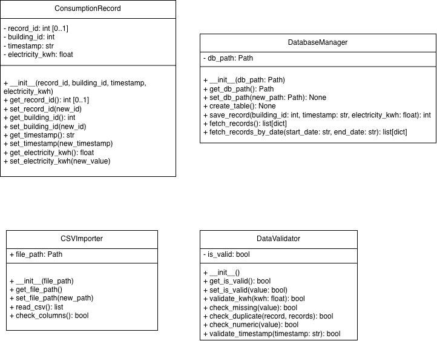

# Hometask 1 – Object-Oriented Programming

**Project:** Carbon Compass AI – Enterprise Carbon Footprint Tracker & AI Assistant  
**Student:** Sahra Ozcelik  
**Subsystem:** Data Management

## 1. Project Overview

The Data Management subsystem is responsible for reading, validating, and storing electricity consumption data.

The main objective of this homework is to implement object-oriented programming concepts in Python, including classes, constructors, encapsulation, getters, and setters.

## 2. Implemented Classes

### ConsumptionRecord

Represents an individual electricity consumption record.

Attributes:
- `record_id`
- `building_id`
- `timestamp`
- `electricity_kwh`

The class includes a constructor, getters, and setters. Its electricity consumption setter accepts non-negative values.

### CSVImporter

Handles reading CSV files containing electricity consumption records.

Main methods:
- `read_csv()` – Reads records from a CSV file.
- `check_columns()` – Checks for the required columns.
- Getter and setter for the file path.

### DataValidator

Checks the validity of electricity consumption data.

Main methods:
- `validate_kwh()` – Validates non-negative consumption.
- `check_missing()` – Detects missing values.
- `check_duplicate()` – Detects duplicate records.
- `check_numeric()` – Checks numeric values.
- `validate_timestamp()` – Validates dates in YYYY-MM-DD format.

The class also includes getter and setter methods for its validation status.

### DatabaseManager

Manages electricity consumption records using SQLite.

Main methods:
- `create_table()` – Creates the consumption records table.
- `save_record()` – Inserts a record.
- `fetch_records()` – Retrieves stored records.
- `fetch_records_by_date()` – Retrieves records within a specified date range.

The class also includes a constructor and getter/setter methods for the database path.

## 3. Project Files

- `Data_Management/consumption_record.py` – ConsumptionRecord class.
- `csv_importer.py` – CSVImporter class.
- `data_validator.py` – DataValidator class.
- `database_manager.py` – DatabaseManager class.
- `csv_validation.py` – CSV validation workflow.
- `test_data_management.py` – Demonstration of importing, validating, and storing records.
- `electricity.csv` – Sample electricity consumption data.
- `Data_Management_UML.drawio` – Editable UML diagram.
- `Data_Management_UML.png` – UML diagram image.

## 4. Object-Oriented Programming Concepts

This implementation demonstrates:

- **Classes and objects:** Separate classes represent the main Data Management responsibilities.
- **Constructors:** `__init__()` methods initialize objects.
- **Encapsulation:** Private attributes are used in ConsumptionRecord, DataValidator, and DatabaseManager.
- **Getters and setters:** Methods provide access to and modification of object attributes.

## 5. Data Validation

The validation process checks for:

- Required CSV columns
- Missing values
- Invalid timestamps
- Non-numeric electricity consumption
- Negative electricity consumption
- Duplicate records

Valid records can then be stored in the SQLite database.

## 6. Database Storage

SQLite is used for local data storage.

The `consumption_records` table contains:

- `record_id`
- `building_id`
- `timestamp`
- `electricity_kwh`

Parameterized SQL queries are used when inserting records and filtering records by date.

## 7. UML Class Diagram

The Data Management UML class diagram is provided in both `.drawio` and `.png` formats.



## 8. Running the Project

Python 3 is required. The implementation uses Python standard-library modules, including `csv`, `datetime`, and `sqlite3`.

From the `Homeworkassignment1/Sahra` folder, run the data management demonstration using:

```bash
PYTHONPATH="$PWD/Data_Management:$PWD" python3 test_data_management.py
```

The script reads `electricity.csv`, checks the records, and saves valid, non-duplicate records to a local SQLite database named `carbon_compass.db`.

The script prints messages indicating whether records were saved, already existed, or were invalid.

## 9. My Contribution

I developed the Data Management subsystem using Python and object-oriented programming principles.

My contribution includes CSV importing, data validation, electricity consumption records, SQLite database operations, and the Data Management UML class diagram.

The subsystem prepares electricity consumption data for the Carbon Calculation and Analytics subsystem.
