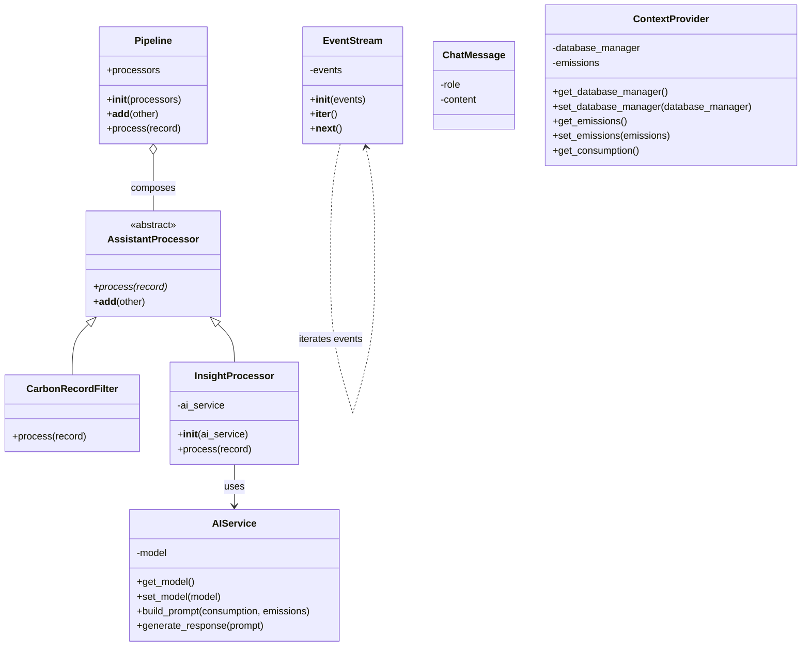

# Carbon Compass AI — Homework Assignment 2

**Project:** Enterprise Carbon Footprint Tracker & AI Assistant  
**Subsystem:** AI Sustainability Assistant  
**Purpose:** Demonstrate an event-driven stream-processing framework using Python OOP concepts.

## 1. Project overview

Carbon Compass AI receives operational carbon-footprint records, validates and filters them, and passes valid calculated results to an AI sustainability assistant. The assistant explains the available metrics and provides general energy-saving suggestions.

This subsystem consumes calculated carbon data. Carbon-emission calculations and emission-factor conversions belong to the Carbon Calculation & Analytics subsystem.

> **Data integrity:** The assistant should explain only the metrics supplied to it. It must not invent emission totals, emission factors, comparisons, or numerical savings.

## 2. Stream-processing workflow

The current implementation demonstrates event-by-event processing with a simulated stream of sample records:

1. `event_generator()` yields records one at a time.
2. `EventStream` consumes the generated events using the iterator protocol.
3. `CarbonRecordFilter` rejects records that are malformed or have unsupported scope tags or negative values.
4. `InsightProcessor` builds a prompt from a valid calculated record.
5. `AIService` sends the prompt to the locally running Ollama model and returns the generated explanation.
6. `Pipeline` composes processors and passes each record through them in sequence.

The sample generator demonstrates lazy, event-by-event processing. It is a simulated stream, not a connection to live smart meters or a message broker.

## 3. OOP concepts required by the assignment

| Professor's requirement | Implementation |
|---|---|
| Abstract Base Class and `@abstractmethod` | `AssistantProcessor` defines the common `process()` contract. |
| Inheritance and polymorphism | `CarbonRecordFilter` and `InsightProcessor` implement the same processor interface. |
| Operator overloading | `__add__` combines processors into a `Pipeline`. |
| Iterator | `EventStream` implements `__iter__()` and `__next__()`. |
| Generator | `event_generator()` yields records one by one. |

## 4. Class diagram

The following Mermaid class diagram documents the stream-processing and AI-assistant classes.



`event_generator(records)` is a generator function, so it is described in the workflow rather than as a class in this class diagram.

## 5. Main files

| File | Responsibility |
|---|---|
| `insight_processor.py` | Abstract processor contract and AI insight processor |
| `ai_service.py` | Builds prompts and communicates with local Ollama |
| `carbon_record_filter.py` | Filters invalid carbon activity records |
| `pipeline.py` | Composes and executes processors |
| `stream_processor.py` | Event iterator and generator |
| `context_provider.py` | Provides consumption and emissions context |
| `chat_message.py` | Represents a chat message |
| `test_*.py` | Test and demonstration scripts |
| `AI-Assistant-UML.png` | UML diagram image, if kept up to date |

## 6. Requirements

- Python 3
- Ollama installed and running
- Ollama model `llama3.2:1b`

The Python code uses the local Ollama HTTP API at `http://localhost:11434`.

## 7. Run the project

Open PowerShell in the project directory.

Start Ollama (if it is not already running):

```powershell
ollama run llama3.2:1b
```

Keep Ollama running, open a second PowerShell terminal, activate the project's virtual environment if applicable, and run the tests from the project directory.

Examples:

```powershell
python test_ai_service.py
python test_carbon_record_filter.py
python test_stream_processor.py
python test_pipeline.py
python test_polymorphism.py
python test_complete_stream.py
```

Some AI-related tests call the local model and may take longer than ordinary unit tests. The Ollama model must be available for those tests.

## 8. Test files

The repository contains test scripts for:

- AI service communication
- Carbon record filtering
- Chat messages
- Context provider
- Insight processor
- Pipeline composition
- Polymorphism
- Stream iteration and generation
- Complete stream processing

Run each test script and check its console output. Do not describe a test as passing unless it has been executed successfully.

## 9. Example input record

The following is an illustrative record. Its emission values are sample values, not official emission factors or measured company data.

```python
sample_record = {
    "timestamp": "2026-11-01",
    "electricity_kwh": 1500,
    "scope": 2,
    "emissions_kg_co2e": 600,
    "emissions_tonnes_co2e": 0.6
}
```

The carbon-calculation subsystem is responsible for calculating the CO2e values using the appropriate emission factors. The AI assistant receives and explains those calculated values.

## 10. Five-minute presentation video

**Video link:** TODO — add the actual link to the recorded five-minute presentation.

Suggested presentation structure:

1. Project purpose and selected use case
2. Required OOP concepts: ABC, inheritance/polymorphism, operator overloading, iterator/generator
3. Stream and pipeline architecture
4. Demonstration of a valid and an invalid record
5. AI assistant response and project limitations

## 11. Submission

Before submission:

- [ ] Confirm that the class diagram matches the final source code.
- [ ] Run the relevant test scripts.
- [ ] Add the real five-minute video URL above.
- [ ] Commit the solution to the branch named exactly `HomeworkAssignment2`.
- [ ] Push the branch to the remote Git repository.
- [ ] Submit the repository/branch link as instructed by the professor.
