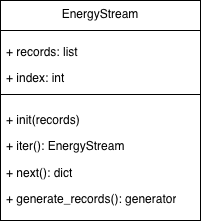

# Hometask 2 – Real-Time Data Processing

**Project:** Carbon Compass AI  
**Student:** Sahra Ozcelik  
**Subsystem:** Data Management

## Overview

This contribution uses Python iterators and generators to access existing electricity consumption records one at a time. The `EnergyStream` class does not collect live sensor data.

## Class and Methods

**Class:** `EnergyStream` (`Data_Management_HA2/energy_stream.py`)

| Method | Description |
|---|---|
| `__init__(records)` | Stores the records and initializes the index. |
| `__iter__()` | Resets the index and returns the iterator. |
| `__next__()` | Returns the next record or raises `StopIteration`. |
| `generate_records()` | Yields records one by one. |

## Files

- `Data_Management_HA2/energy_stream.py` – Iterator and generator implementation.
- `Data_Management_HA2/test_energy_stream.py` – Demonstration with records retrieved through Hometask 1's `DatabaseManager` (not an automated unit test).
- `UML_Diagrams_HA2/HA2SAHRAUML.drawio` – Editable UML diagram.
- `UML_Diagrams_HA2/HA2SAHRAUML.png` – UML diagram image.

## UML Diagram



## Run a Simple Example

From the `Data_Management_HA2` folder, run:

```bash
python3 -c 'from energy_stream import EnergyStream; print(list(EnergyStream([{"electricity_kwh": 120}, {"electricity_kwh": 150}])))'
```

This example needs Python 3 only. The separate `test_energy_stream.py` script requires the Hometask 1 `DatabaseManager` module in a sibling folder named `Data_Management`. That folder is not included in this Hometask 2 submission.

## My Contribution

I implemented the `EnergyStream` iterator and generator, the demonstration script, and the accompanying UML diagram for the Data Management subsystem.
