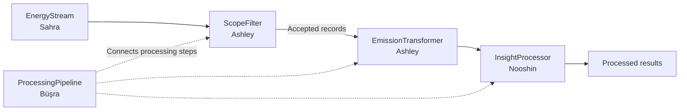
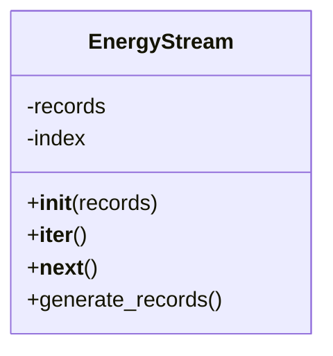
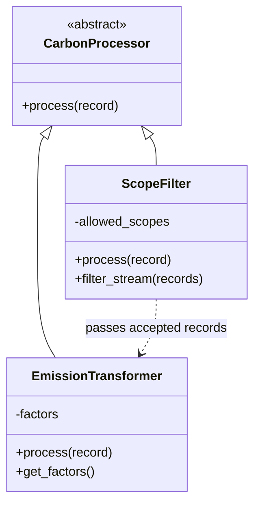
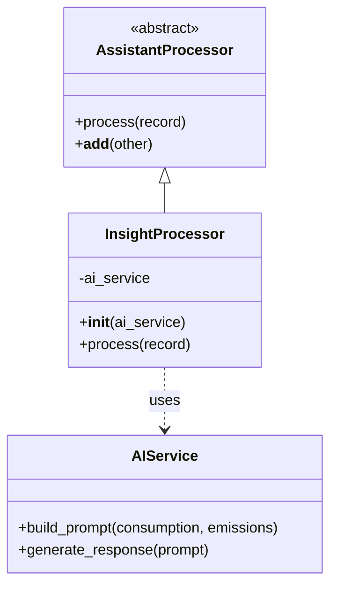
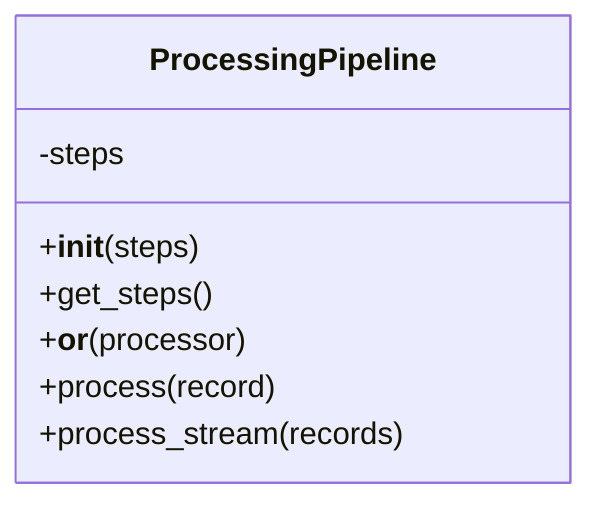

# Carbon Compass AI

### Enterprise Carbon Footprint Tracker & AI Assistant

**FH Dortmund | Python Compact Course | Homework Assignment 2 — Real-Time Data Processing**

## 1. Project Overview

Carbon Compass AI is a Python-based capstone project for tracking electricity consumption, estimating associated greenhouse gas emissions, and preparing information for a dashboard and AI sustainability assistant.

For Homework Assignment 2, our team focuses on an **event-driven processing pipeline**. Rather than analyzing only a finished CSV file, the program processes individual activity records in sequence. The initial demonstration uses **electricity consumption for one building**; the filtering and transformation interfaces also illustrate how records tagged as Scope 1, 2, or 3 can be handled.

The homework demonstrates abstract base classes, inheritance, polymorphism, operator overloading, iterators, and generators.

## 2. Team Overview

| Team member | Subsystem | HA2 contribution |
|---|---|---|
| **Sahra Özçelik** | Data Management | `EnergyStream` — iterates over records and provides a generator |
| **Ashley Eshghi** | Carbon Calculation & Analytics | `CarbonProcessor`, `ScopeFilter`, and `EmissionTransformer` — filters activity scopes and calculates emissions |
| **Nooshin Janizadeh** | AI Sustainability Assistant | `AssistantProcessor` and `InsightProcessor` — defines an AI-processing interface and prepares insights from calculated records |
| **Büşra Aydın** | Web Interface / Pipeline Integration | `ProcessingPipeline` — connects processing steps using the overloaded `|` operator |

Each student maintains their own code and tests in the corresponding folder under `Homeworkassignment2/`.

## 3. Processing Architecture



The intended data flow is:

1. **Ingestion:** `EnergyStream` makes activity records available one at a time.
2. **Filtering:** `ScopeFilter` retains records matching the selected emission scope; others return `None`.
3. **Transformation:** `EmissionTransformer` applies an activity-specific emission factor and returns estimated emissions in kilograms and metric tonnes of CO₂e.
4. **Insights:** `InsightProcessor` consumes the transformed record and can add an AI-based explanation.
5. **Composition:** `ProcessingPipeline` runs the processor steps in order, skipping filtered-out records.

**Integration status:** The subsystem modules were developed separately. This diagram represents the intended combined pipeline; complete team-wide integration and testing should be confirmed before the final demonstration.

## 4. UML Class Diagrams

The class diagrams below render directly on GitHub. Original UML drawings or exported images can also be kept in each student's folder.

### 4.1 Data Management — Sahra

`EnergyStream` implements the iterator protocol with `__iter__()` and `__next__()`, and provides `generate_records()` using `yield`.



### 4.2 Carbon Calculation & Analytics — Ashley

`CarbonProcessor` defines an abstract `process(record)` contract. `ScopeFilter` and `EmissionTransformer` inherit from it and provide different implementations, demonstrating inheritance and polymorphism.



### 4.3 AI Sustainability Assistant — Nooshin

`AssistantProcessor` defines a common processing interface. `InsightProcessor` uses an AI service to prepare an explanation using calculated consumption and emissions data.



### 4.4 Web Interface / Pipeline Integration — Büşra

`ProcessingPipeline` stores a sequence of processors, connects them with `__or__()` (the `|` operator), and runs each processor's `process()` method in order.



> **UML note:** These diagrams document the HA2 processing classes, not every class from the final capstone application. Diagrams should be updated if the submitted class names or method signatures change.

## 5. Main Object-Oriented Concepts

| Concept | Implementation |
|---|---|
| **Abstract Base Classes** | `CarbonProcessor` and `AssistantProcessor` define a `process()` interface |
| **Inheritance** | `ScopeFilter` and `EmissionTransformer` inherit from `CarbonProcessor`; `InsightProcessor` inherits from `AssistantProcessor` |
| **Polymorphism** | Different processors provide their own behavior through the same `process(record)` method |
| **Operator Overloading** | `ProcessingPipeline.__or__()` allows composition using the `|` operator |
| **Iterators** | `EnergyStream.__iter__()` and `__next__()` retrieve records sequentially |
| **Generators** | `EnergyStream.generate_records()`, `ScopeFilter.filter_stream()`, and `ProcessingPipeline.process_stream()` yield records one at a time |

## 6. Data Format and Emissions Calculation

The processors exchange **Python dictionaries**. An electricity event may contain:

```python
{
    "record_id": 1,
    "building_id": 1,
    "timestamp": "2026-01-01",
    "electricity_kwh": 120.0,
    "scope": 2
}
```

The calculation follows:

**Emissions (kg CO₂e) = Electricity consumption (kWh) × Emission factor (kg CO₂e/kWh)**

**Emissions (tonnes CO₂e) = Emissions (kg CO₂e) / 1,000**

For illustration, `120 kWh × 0.4 kg CO₂e/kWh = 48 kg CO₂e = 0.048 tonnes CO₂e`.

**The factor `0.4` is hypothetical and is not suitable for official greenhouse gas reporting.**

## 7. Running the Demonstration and Tests

Use Python 3.10 or newer. Ashley's standalone processing files use only Python's standard library.

From the repository root on the HA2 submission branch, run:

```bash
python Homeworkassignment2/Ashley/Carbon_Calculation_Analytics/demo_ashley.py
```

Example output:

```text
Record 1: 0.04800 t CO2e
Record 2: 0.06000 t CO2e
```

Run Ashley's tests:

```bash
python -m unittest discover -s Homeworkassignment2/Ashley/Carbon_Calculation_Analytics -p "test_*.py" -v
```

Other subsystems may require additional packages (particularly for AI integration); consult their individual READMEs and execute the combined pipeline tests after integration.

## 8. Repository Organization

```text
Homeworkassignment2/
├── Sahra/       # Data stream and iterator/generator code
├── Ashley/      # Scope filtering and emissions transformation
├── Nooshin/     # AI-related processors
└── Busra/       # ProcessingPipeline and operator overloading
```

Each member's folder contains the corresponding source code, and where supplied, tests, documentation, and original UML exports.

## 9. Team Video Presentation

**Unified team presentation (3–5 minutes): [ADD VIDEO LINK BEFORE SUBMISSION]**

Every member will briefly explain their classes, show the corresponding UML diagram, and demonstrate the relevant Python implementation. The final video link must be accessible to the professor.

## 10. Project Status

Homework Assignment 2 establishes a modular stream-processing approach that can be reused in the final Carbon Compass AI application. The example processes recorded events sequentially; live external telemetry and full end-to-end AI integration are separate integration tasks and should not be claimed as complete until tested.
