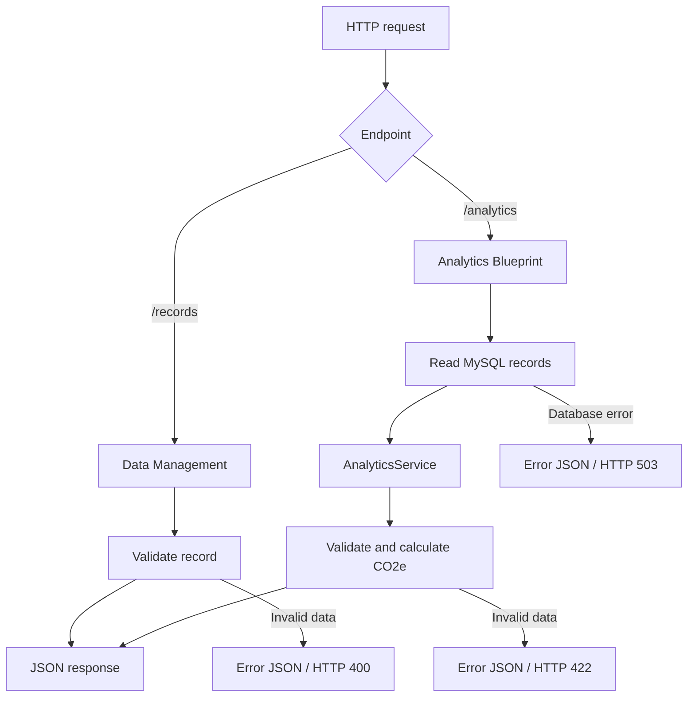

# Carbon Compass AI

### Homework Assignment 4 — Exception Handling and Unit Testing

**FH Dortmund | Python Compact Course | Team Project**  
**GitHub branch:** `Homeworkassignment004`

## 1. Project Overview

Carbon Compass AI is a Python application for managing building electricity consumption, estimating associated carbon emissions, and supporting sustainability analysis.

Homework Assignment 4 focuses on making the existing Flask and MySQL components more reliable through **custom exceptions, input validation, HTTP error responses, and automated unit tests**. The current documented tests cover Data Management and Carbon Calculation & Analytics.

## 2. Team and Subsystems

| Team member | Subsystem | Responsibility |
|---|---|---|
| Sahra Özçelik | Data Management | Validate electricity records, handle invalid requests, and test record endpoints |
| Ashley Eshghi | Carbon Calculation & Analytics | Validate emissions data, handle analytics API errors, and test calculations and responses |
| Nooshin Janizadeh | AI Sustainability Assistant | AI recommendations and related processing |
| Büşra Aydın | Web Interface | User interface and dashboard |

Each member maintains their contribution in a separate folder. The documented HA4 exception classes and tests below are from the Data Management and Analytics submissions.

## 3. Error Handling

### Data Management — Sahra

- **`data_management_error.py`** defines `DataManagementError`, a custom exception class.
- **`app.py`** implements `GET /records` and `POST /records` using Flask and MySQL.
- Invalid JSON, missing fields, negative consumption, and nonnumeric consumption are rejected with HTTP **400 Bad Request** responses.

### Carbon Calculation & Analytics — Ashley

- **`analytics_error.py`** defines `AnalyticsError`, derived from `ValueError`, with a message and HTTP status code.
- **`analytics_service.py`** checks emission factors, electricity values, and timestamps before generating total and monthly emissions summaries.
- **`analytics_api.py`** provides `GET /analytics?building_id=1` through a Flask Blueprint, converts `AnalyticsError` into JSON responses, and closes database resources in a `finally` block.

| HTTP status | Meaning | Analytics example |
|---|---|---|
| `200` | Successful request | Returns electricity and CO₂e summaries |
| `400` | Invalid request | Invalid `building_id` |
| `422` | Invalid analytics data | Negative or malformed electricity data |
| `503` | Database unavailable | MySQL connection or query fails |

**Important:** The example emission factor of **0.4 kg CO₂e/kWh** is hypothetical and is not suitable for official carbon reporting.

## 4. Application Flow



The subsystems use the existing `carbon_compass` MySQL database and its `consumption_records` table. The Analytics Blueprint is designed to be registered in the team's shared Flask application; it can also be run separately for testing.

## 5. Automated Unit Tests

Python's built-in **`unittest`** framework is used for assertions and test organization. Flask's **test client** sends requests without starting a live web server, while **`unittest.mock`** simulates MySQL connections.

| Contributor | Test file | Tests | What is checked |
|---|---|---:|---|
| Sahra | `test_app.py` | 4 | Missing fields, negative/non-numeric electricity data, and retrieving records |
| Ashley | `test_analytics_service.py` | 8 | Emissions calculations, monthly results, empty/zero data, and invalid inputs |
| Ashley | `test_analytics_api.py` | 3 | Successful response, invalid building ID, and database failure |
| **Total** | | **15** | **15 distinct test methods are defined** |

These tests do not require a running MySQL server because database access is mocked. The complete set still needs to be executed in the final team environment to confirm that all tests pass.

## 6. Repository Structure

```text
Homeworkassignment4/
├── Sahra/
│   └── Data_Management/
│       ├── app.py
│       ├── data_management_error.py
│       └── test_app.py
├── Ashley/
│   └── Carbon_Calculation_Analytics/
│       ├── analytics_error.py
│       ├── analytics_service.py
│       ├── analytics_api.py
│       ├── test_analytics_service.py
│       └── test_analytics_api.py
├── Nooshin/              # AI Sustainability Assistant
└── Busra/                # Web Interface
```

Each student's folder may also contain their own README and supporting materials. The structure above shows the key files discussed in this assignment.

## 7. Install and Run Tests

**Requirements:** Python 3, Flask, and `mysql-connector-python`.

Install the Python packages:

```powershell
python -m pip install Flask mysql-connector-python
```

From the **`Homeworkassignment4/Ashley`** folder, run the analytics tests:

```powershell
python -m unittest discover -s Carbon_Calculation_Analytics -p "test_*.py" -v
```

From the **`Homeworkassignment4/Sahra/Data_Management`** folder, run the Data Management tests:

```powershell
python -m unittest test_app.py -v
```

A Python virtual environment is optional. `.venv/`, `__pycache__/`, `.pyc`, and passwords should not be committed to GitHub.

## 8. Team Presentation Video

**HA4 presentation video:** [Watch our HA4 presentation](PASTE_VIDEO_LINK_HERE)

The video demonstrates the custom exception classes, Flask error handling, representative unit tests, and how the Data Management and Analytics components relate to the project.

> **Before submission:** Replace `PASTE_VIDEO_LINK_HERE` with the actual accessible video URL.

## 9. Submission Notes

- Assignment branch: `Homeworkassignment004`.
- This README documents **15 defined tests** from the two available subsystem submissions.
- Because HA4 asks for an error-handling class for **each subsystem**, confirm that the AI Assistant and Web Interface contributions also include the required exception-handling classes before final submission.
- Real database execution requires the team's configured MySQL server. Automated mocked tests do not.
