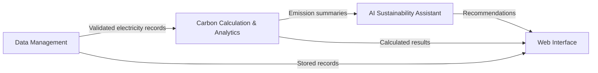
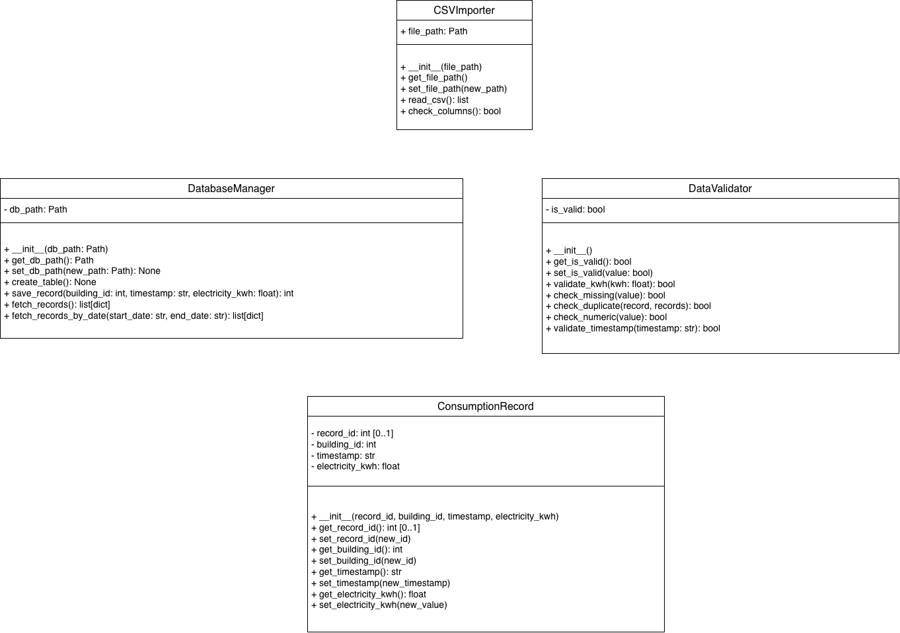

# Carbon Compass AI

### Enterprise Carbon Footprint Tracker & AI Assistant

**FH Dortmund | Python Compact Course | Homework Assignment 1 — Object-Oriented Programming**

## 1. Project Overview

Carbon Compass AI is a Python-based capstone project designed to help organizations record building electricity consumption, estimate associated greenhouse gas emissions, view analytical summaries, and obtain sustainability advice.

Our initial implementation focuses on **one building and electricity consumption (kWh)**.

Homework Assignment 1 establishes the project's object-oriented structure. Each team member implements classes for an assigned subsystem, using constructors, initialization methods, getters/setters, and clearly defined responsibilities. The subsystems are designed to work together as the project develops.

## 2. Team Overview

| Team member | Assigned subsystem | Main responsibility |
|---|---|---|
| Sahra Özçelik | Data Management | CSV import, validation, consumption records, and storage |
| Ashley Eshghi | Carbon Calculation & Analytics | Emission factors, CO₂e calculations, aggregation, and reports |
| Nooshin Janizadeh | AI Sustainability Assistant | Prompt context, AI responses, and chat messages |
| Büşra Aydın | Web Interface | Application navigation, forms, dashboards, and display pages |

## 3. System Architecture

The planned flow between the four subsystems is:



This diagram illustrates the intended data flow between the subsystems. Full integration is addressed in subsequent development stages.

## 4. UML Class Diagrams

The following UML diagrams document the class structure and relationships of the four subsystems. Each team member's individual folder also contains their implementation and original UML files.

### 4.1 Data Management — Sahra

The subsystem includes `CSVImporter`, `DataValidator`, `DatabaseManager`, and `ConsumptionRecord`.

These classes handle importing CSV files, validating electricity data, representing consumption records, and managing database storage.



### 4.2 Carbon Calculation & Analytics — Ashley

The subsystem includes `EmissionFactor`, `BaseCalculator`, `CarbonCalculator`, `EmissionResult`, and `AnalyticsService`, alongside the shared `ConsumptionRecord` class.

`CarbonCalculator` inherits from the abstract `BaseCalculator` class. It uses validated consumption records and emission factors to create calculated emission results, which are then processed by `AnalyticsService`.


### 4.3 AI Sustainability Assistant — Nooshin

The subsystem contains `AIService`, `ContextProvider`, and `ChatMessage`.

These classes support preparing sustainability context, generating AI responses, and representing chat messages. `ContextProvider` also depends on the Data Management interface.


### 4.4 Web Interface — Büşra

The subsystem contains `AppController`, `DashboardPage`, `DataUploadPage`, `AnalyticsPage`, and `AssistantPage`.

These classes organize navigation, activity upload, emissions visualization, and interaction with the AI Assistant. The Streamlit `app.py` module serves as the interface entry point.


## 5. Object-Oriented Design

The subsystems demonstrate several object-oriented programming concepts:

- **Constructors and initialization:** Objects are initialized with defined attributes and values.
- **Encapsulation:** Getter and setter methods allow controlled access to class attributes.
- **Abstraction:** The Carbon Calculation subsystem includes an abstract `BaseCalculator`.
- **Inheritance:** `CarbonCalculator` inherits from `BaseCalculator` and implements its calculation interface.
- **Separation of responsibilities:** Data storage, calculations, AI operations, and the user interface are organized into separate subsystems.

## 6. Repository Organization

```text
Homeworkassignment1/
├── Sahra/         # Data Management
├── Ashley/        # Carbon Calculation & Analytics
├── Nooshin/       # AI Sustainability Assistant
├── Busra/         # Web Interface
└── UML_Diagrams/  # Rendered diagrams for this README
```

Each member's folder contains their assigned subsystem implementation, including Python classes and supporting files.

Individual README files provide further technical explanations and, where available, demonstration and testing instructions.

The `ConsumptionRecord` class is shared between Data Management and Analytics to maintain a consistent data structure.

## 7. Demonstration and Testing

The team developed subsystem demonstrations and tests to check the behavior of the implemented classes.

The presentation explains the responsibilities of each subsystem, the UML class relationships, and how the implemented Python methods demonstrate object-oriented programming concepts.

**Team presentation video (3–5 minutes): [ADD VIDEO LINK BEFORE SUBMISSION]**

## 8. Project Status

Homework Assignment 1 establishes the object-oriented foundation of Carbon Compass AI.

The complete data-processing pipeline, integrated web API, extended exception handling, and final application integration are addressed in subsequent homework assignments and capstone development.
