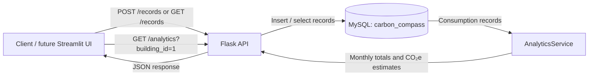
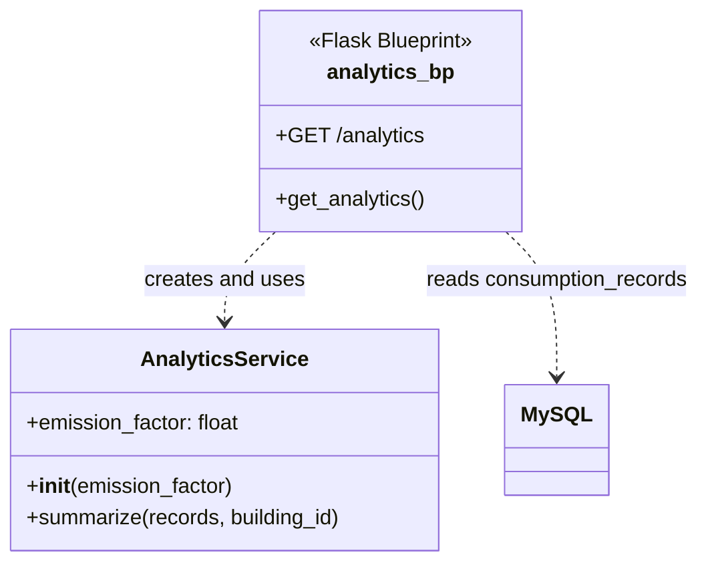

# Carbon Compass AI

### Enterprise Carbon Footprint Tracker & AI Assistant

**FH Dortmund · Python Compact Course · Homework Assignment 3 — Web APIs & Database Access Layers**

## 1. Project Overview

Carbon Compass AI is a Python-based project for recording building electricity consumption, calculating estimated associated carbon emissions, and making the results available to a future web dashboard and AI sustainability assistant.

In **Homework Assignment 3**, the team focuses on web APIs and database access using **Flask** and **MySQL**. The current demonstration uses electricity data for a building. Sahra's Data Management component adds and retrieves records, while Ashley's Carbon Calculation & Analytics component reads the same data and returns calculated summaries as JSON.

The emissions factor of **0.4 kg CO₂e/kWh is hypothetical and for demonstration only**, not an official factor for corporate carbon reporting.

## 2. Team Overview

| Team member | Assigned subsystem | Responsibility |
|---|---|---|
| Sahra Özçelik | Data Management | Flask endpoints for inserting and retrieving electricity records in MySQL |
| Ashley Eshghi | Carbon Calculation & Analytics | Emissions calculations, monthly summaries, and the Flask analytics endpoint |
| Nooshin Janizadeh | AI Sustainability Assistant | AI-based explanations and sustainability recommendations in the wider project |
| Büşra Aydın | Web Interface | User forms, dashboards, and presentation of the results in the wider project |

The endpoints documented below are the **verified design of the Data Management and Analytics contributions**. Other subsystems are listed as team responsibilities; this README does not claim their HA3 integration is complete.

## 3. Architecture and Data Flow



**Implementation approach:** The components can run separately while being developed. For the integrated application, Ashley's `analytics_bp` Flask Blueprint is registered in Sahra's Flask app so the routes share one server and database.

## 4. Implemented API Components

| Endpoint | Method | Subsystem | Purpose |
|---|---|---|---|
| `/` | GET | Data Management | Show a basic API status message |
| `/records` | GET | Data Management | Retrieve electricity consumption records |
| `/records` | POST | Data Management | Add a new electricity consumption record |
| `/analytics?building_id=1` | GET | Carbon Calculation & Analytics | Calculate totals and monthly emissions for a selected building |

The analytics endpoint returns fields such as `building_id`, `record_count`, `total_electricity_kwh`, `emissions_kg_co2e`, `emissions_tonnes_co2e`, and a `monthly` list. It also identifies the example emission factor in its response.

### Analytics design



The diagram above shows the main HA3 responsibilities. `analytics_bp` is a **Flask Blueprint object**, not a Python class. It is drawn as a component for readability rather than as a literal class definition.

## 5. Shared MySQL Database

The analytics subsystem **does not create or modify tables**. It reads Sahra's existing `carbon_compass` database and `consumption_records` table.

```sql
CREATE DATABASE IF NOT EXISTS carbon_compass;
USE carbon_compass;

CREATE TABLE IF NOT EXISTS consumption_records (
    record_id INT AUTO_INCREMENT PRIMARY KEY,
    building_id INT NOT NULL,
    timestamp DATE NOT NULL,
    electricity_kwh DOUBLE NOT NULL
);
```

Example record for testing:

```json
{
  "building_id": 1,
  "timestamp": "2026-01-02",
  "electricity_kwh": 150.0
}
```

For an illustrative input of **150 kWh** and a hypothetical factor of **0.4 kg CO₂e/kWh**, the estimated emissions are **60 kg CO₂e**, or **0.06 tonnes CO₂e**.

## 6. Technologies

- **Python** — application logic and calculations
- **Flask** — API endpoints and JSON responses
- **MySQL Community Server** — shared database
- **mysql-connector-python** — Python–MySQL connection
- **`unittest` and `unittest.mock`** — automated tests and simulated database access

## 7. Repository Organization

```text
Homeworkassignment3/
├── Sahra/                             # Data Management contribution
├── Ashley/
│   ├── Carbon_Calculation_Analytics/
│   │   ├── analytics_api.py            # AnalyticsService + Flask Blueprint
│   │   └── test_analytics.py           # Calculation and mocked API tests
│   ├── README.md                       # Individual documentation
│   └── requirements.txt                # Python dependencies, if included
├── Nooshin/                           # AI Assistant contribution
└── Busra/                             # Web Interface contribution
```

Each student maintains their own contribution. The group README describes the shared project and integration plan.

## 8. Setup and Testing

Install Python, MySQL Community Server, and the Python packages **Flask** and **mysql-connector-python**. MySQL Workbench is optional but useful for managing the database.

From the repository root, install the packages into your chosen Python environment:

```powershell
python -m pip install Flask mysql-connector-python
```

Create the MySQL database and table using the SQL above. To run Ashley's standalone analytics endpoint, open her subsystem folder in a terminal and execute:

```powershell
python analytics_api.py
```

Enter your **own local MySQL password** when prompted, then visit:

`http://127.0.0.1:5051/analytics?building_id=1`

The unit tests use mocked database connections, so **MySQL Server does not have to be running for the tests**. From the folder containing Ashley's `analytics_api.py` and `test_analytics.py`:

```powershell
python -m unittest -v test_analytics.py
```

The current uploaded analytics test file defines **six tests** for totals, empty data, invalid consumption, invalid factors, a mocked Flask database request, and invalid building IDs. A passing live MySQL integration test must be verified separately on a machine with MySQL running.

## 9. Team Video Presentation

**Unified team presentation: [https://drive.google.com/file/d/1zq2NoJae4KMYpOdRvpMNgbvwfH-8sbTN/view?usp=sharing]**

## 10. Submission Status and Limitations

This HA3 contribution demonstrates the Flask/MySQL data-access design and the carbon analytics route. A local, configured MySQL server is required for a complete live demonstration. The analytics code uses a hypothetical emissions factor and should not be used for official carbon accounting without verified factors and an agreed methodology.

**GitHub submission branch:** `Homeworkassignment003`  
**Repository:** [Carbon-Compass-AI](https://github.com/AshEshghi/Carbon-Compass-AI/tree/Homeworkassignment003)
