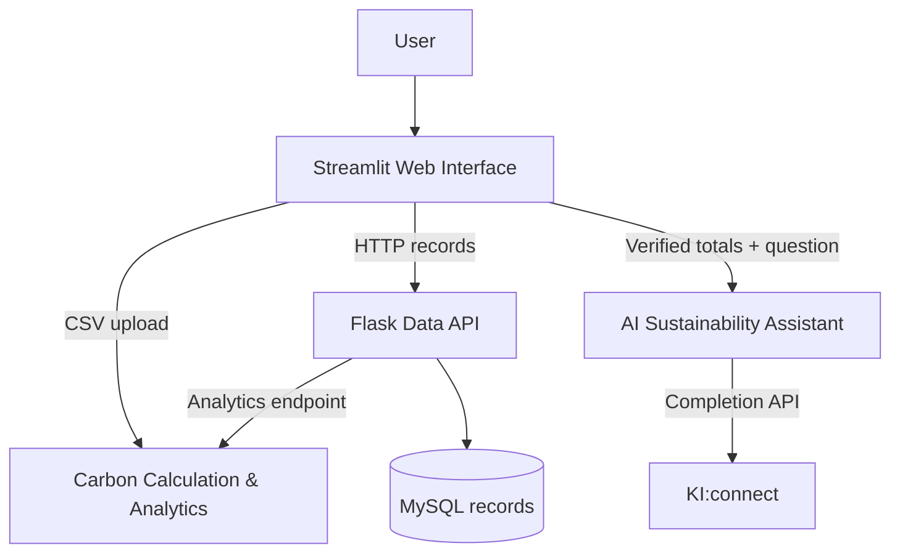

# Carbon Compass AI

**Enterprise Carbon Footprint Tracker & AI Sustainability Assistant**  
**FH Dortmund — Group 29, Topic 3 | Academic capstone project**

Carbon Compass AI is a modular Python prototype for importing building electricity-consumption data, validating records, estimating electricity-related carbon emissions, visualizing monthly trends, and generating contextual sustainability guidance with generative AI. It combines **Flask, MySQL, Streamlit, Python analytics, and KI:connect**.

> **Important:** This is an educational minimum viable product (MVP), not a certified greenhouse-gas inventory. It uses a **hypothetical emission factor of 0.4 kg CO₂e/kWh**; this is not an official German grid factor.

## Team and responsibilities

| Member | Responsibility | Directory |
| --- | --- | --- |
| **Sahra Özcelik** | CSV ingestion, validation, persistence, Flask data API | `Data_Management/` |
| **Ashley Eshghi** | Carbon calculations, aggregation, analytics API, tests, UML | `Carbon_Calculation_Analytics/` |
| **Nooshin Janizadeh** | AI prompts, KI:connect integration, sustainability guidance | `AI_Sustainability_Assistant/` |
| **Büşra Aydın** | Streamlit pages, navigation, dashboard, visualizations | `Web_Interface/` |

## Features

1. **Import electricity data:** Validate CSV dates, numeric kWh values, and duplicate records; report invalid rows.
2. **Retrieve stored readings:** MySQL stores consumption records; Flask exposes APIs for records, CSV uploads and analytics.
3. **Calculate emissions:** Estimate kg CO₂e from kWh and aggregate results by month.
4. **Explore dashboards:** Streamlit offers **Dashboard**, **Upload Data**, **Analytics**, and **AI Assistant** pages.
5. **Get AI recommendations:** Send verified consumption/emission totals to KI:connect with instructions to avoid fabricated figures or unsupported savings claims.

The included demonstration uses **Building 1 readings from January to September 2016**. The calculations cover **electricity-related estimated emissions only**, not every organizational emission source.

## System architecture



The UI can calculate results directly from an uploaded CSV without saving it to MySQL. Persisting CSV rows uses Flask's separate `POST /upload-csv` endpoint. In Docker, the web container contacts the Flask service through the network hostname `backend`.

## Repository structure

```text
Carbon-Compass-AI/
├── AI_Sustainability_Assistant/   # AI client, prompts, context and errors
├── Carbon_Calculation_Analytics/  # Ashley's calculation, tests, analytics API and UML
│   ├── api/
│   └── UML Diagrams/
├── Data_Management/              # Flask API, MySQL schema, validators and demo CSVs
├── Web_Interface/                # Streamlit app, pages, requirements and UML
├── .env.example                   # Environment variable template (no secrets)
├── .gitignore
├── Dockerfile
├── compose.yaml                   # db, backend and web services
├── requirements.txt
└── run_analytics_demo.py          # Standalone analytics demonstration
```

## Prerequisites

- **Recommended:** Docker Desktop and Docker Compose.
- **Manual setup:** Python **3.12**, `pip`, and a configured MySQL database.
- **AI feature only:** Authorized KI:connect API key, endpoint and model name. The dashboard and analytics do not require an AI key.

## Quick start — Docker (recommended)

Run the commands from the **repository root** (the directory containing `compose.yaml`).

1. Create your private environment file from the template:

   ```powershell
   Copy-Item .env.example .env
   ```

   On macOS/Linux, use `cp .env.example .env` instead.

2. Edit `.env`: set **different, nonempty** values for `DB_PASSWORD` and `MYSQL_ROOT_PASSWORD`. For the AI feature, set `KICONNECT_API_KEY`, `KICONNECT_BASE_URL`, and `KICONNECT_MODEL`. **Never commit or share `.env`.**

3. Build and start the services:

   ```bash
   docker compose up --build -d
   ```

4. Open **http://localhost:8501** (Streamlit). On your host, Flask is available at **http://localhost:5051**; within Docker, Flask listens on `backend:5050`. MySQL is accessible on the internal Compose network only.

5. **Seed the database.** The schema is created automatically for a fresh database volume, but no demonstration rows are imported automatically. Upload the included Building 1 dataset:

   ```powershell
   curl.exe -X POST -F "file=@Data_Management/carbon_compass_real_daily_building1.csv" http://localhost:5051/upload-csv
   ```

   On macOS/Linux, use `curl` instead of `curl.exe`. In the UI, open **Upload Data** and choose **Load Records from Database**. Then inspect the dashboard and monthly analysis.

Useful diagnostics and shutdown commands:

```bash
docker compose ps
docker compose logs -f backend
docker compose logs -f web
docker compose down
```

The final command keeps the named MySQL volume. **Do not use `docker compose down -v` unless you intend to delete its stored data.**

## Run locally without Docker (Windows PowerShell)

Create a Python virtual environment and install dependencies:

```powershell
py -3.12 -m venv .venv
.\.venv\Scripts\Activate.ps1
python -m pip install -r requirements.txt
```

Create the MySQL database `carbon_compass` and apply the schema in `Data_Management/carbon_compass_mysql.sql`. Then set the connection variables and start the backend:

```powershell
$env:MYSQL_HOST = "localhost"
$env:MYSQL_USER = "root"
$env:MYSQL_PASSWORD = "YOUR_LOCAL_PASSWORD"
$env:MYSQL_DATABASE = "carbon_compass"
python -m Data_Management.app
```

In another terminal, activate `.venv` and run:

```powershell
python -m streamlit run Web_Interface/app.py
```

By default, the UI talks to `http://127.0.0.1:5050`. Set `DATA_API_BASE_URL` in the Streamlit environment to change this. For local AI responses, populate `KICONNECT_*` in a root `.env` file using `.env.example` as a template.

## API reference

The `consumption_records` table uses `record_id` (generated primary key), `building_id`, `timestamp`, and `electricity_kwh`.

| Method | Endpoint | Purpose |
| --- | --- | --- |
| `GET` | `/` | Backend status and description |
| `GET` | `/records` | Query records (optional `start_date` / `end_date`) |
| `POST` | `/records` | Save an individual reading as JSON |
| `POST` | `/upload-csv` | Validate and persist a multipart CSV file under `file` |
| `GET` | `/analytics?building_id=1` | Calculate Jan–Sep 2016 analytics for one building |

Examples for a Docker deployment:

```bash
curl "http://localhost:5051/records?start_date=2016-01-01&end_date=2016-09-30"
curl "http://localhost:5051/analytics?building_id=1"
```

## Carbon calculations

For each valid record:

**Estimated emissions (kg CO₂e) = electricity (kWh) × 0.4 (kg CO₂e/kWh).**

Results can be summarized and grouped by month. The factor is explicitly illustrative. See `Carbon_Calculation_Analytics/README.md` for the component design and `Carbon_Calculation_Analytics/UML Diagrams/Carbon_Analytics_UML.drawio` for its editable class diagram.

## Tests and quality assurance

Run the analytics test suite from the repository root:

```bash
python -m unittest Carbon_Calculation_Analytics.test_carbon_analytics -v
```

**Verified for the prepared package:** 38 analytics tests pass. Coverage includes input validation, factor handling, emissions calculations, monthly aggregation, summaries, and shared Data Management model behavior. Several integration-style cases use in-memory/mock data; they do **not** replace a real MySQL, Docker or KI:connect end-to-end test.

`Data_Management/test_data_management.py` is a **standalone import demonstration** that writes a local SQLite database, despite its filename. Do not treat it as an automatically discovered unit-test suite.

**Final acceptance checklist:** start Docker; import the sample dataset; call both `/records` and `/analytics`; load records in Streamlit; inspect dashboard KPIs/monthly chart; upload an invalid CSV; test AI with permitted KI:connect credentials; and save screenshots or a screen recording as evidence.

## UML diagrams and documentation

- **Ashley (analytics):** `Carbon_Calculation_Analytics/UML Diagrams/` contains editable `.drawio` and preview `.png`/`.html` assets.
- **Büşra (UI):** `Web_Interface/UML/` contains editable class diagrams and previews.
- **UI requirements:** `Web_Interface/WEB_INTERFACE_REQUIREMENTS.md` documents functional/non-functional requirements.
- **Analytics module:** `Carbon_Calculation_Analytics/README.md` describes implementation details.

## Limitations and security

- The demonstration factor is hypothetical; this prototype cannot generate an official greenhouse-gas statement.
- Direct CSV uploads are designed around the expected `timestamp` and `electricity_kwh` columns and Building 1 demonstration flow.
- A new MySQL volume starts without readings until you import data.
- AI answers depend on an external service. The calculated totals remain the trusted source; generated recommendations still require user judgment.
- Production deployment would require additional access control, migrations, secret management, monitoring and end-to-end tests.
- Real `.env` values, keys and passwords must **never** be committed. The repository includes only `.env.example`.

## Team Video Presentation

**Unified team presentation: [https://drive.google.com/file/d/13YX0PAVslJWGIOmQHF9JkD50UKfRtI-8/view?usp=sharing]**

## Contribution workflow

Keep feature work in individual branches, use pull requests for review and run the relevant tests before merging into `main`. Documentation and UML assets should be updated when their corresponding implementation changes.

**GitHub repository:** [AshEshghi/Carbon-Compass-AI](https://github.com/AshEshghi/Carbon-Compass-AI)

*Developed as an educational group project at FH Dortmund.*
