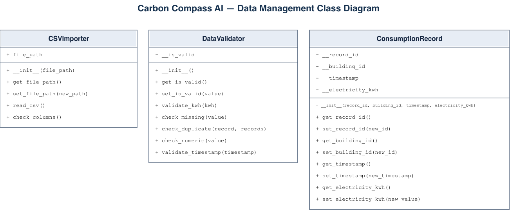

# Carbon Compass AI

**Enterprise Carbon Footprint Tracker & AI Assistant**

## Project Overview

Carbon Compass AI is a Python-based application designed to track building electricity consumption, estimate carbon emissions, visualize energy trends, and provide AI-powered sustainability insights.

The project is divided into four subsystems developed by different team members.

## Team Members and Responsibilities

| Team Member | Subsystem |
|---|---|
| Sahra Özcelik | Data Management |
| Ashley Eshghi | Carbon Calculation & Analytics |
| Nooshin Janizadeh | AI Sustainability Assistant |
| Büşra Aydın | Web Interface |

## System Overview

The intended data flow is:

**CSV Upload → Data Validation → MySQL Database → Flask API → Analytics / Web Interface / AI Assistant**

Each subsystem has a separate responsibility and is integrated into the complete application.

## Technologies

Technologies used in the project include:

- Python
- Flask
- MySQL and MySQL Connector/Python
- Python CSV module
- Python unittest framework
- Streamlit
- Data analysis and visualization libraries
- AI API integration

Additional dependencies and deployment instructions will be documented after final integration.

## Data Management – Sahra Özcelik

The Data Management subsystem is responsible for importing, validating, storing, and providing electricity consumption records.

### Main Features

- Import CSV files containing electricity consumption data.
- Verify required CSV columns.
- Validate timestamps using the `YYYY-MM-DD` format.
- Check missing and non-numeric values.
- Reject negative electricity consumption.
- Detect duplicate records.
- Store validated data in a MySQL database.
- Retrieve records using optional date filters.
- Provide JSON responses through a Flask REST API.

### Python Files

| File | Purpose |
|---|---|
| `csv_importer.py` | Reads CSV files and checks required columns |
| `data_validator.py` | Performs data quality checks |
| `csv_validation.py` | Coordinates CSV validation and collects valid records and errors |
| `consumption_record.py` | Defines the ConsumptionRecord class |
| `app.py` | Implements Flask API endpoints and MySQL operations |
| `carbon_compass_mysql.sql` | Creates the MySQL database and table |
| `test_app.py` | Contains automated API tests |

### API Endpoints

| Method | Endpoint | Description |
|---|---|---|
| GET | `/` | Returns API status |
| GET | `/records` | Retrieves stored consumption records |
| POST | `/records` | Adds an electricity consumption record |
| POST | `/upload-csv` | Uploads and validates a CSV file and saves accepted records |

Date filtering is supported through the `start_date` and `end_date` query parameters on `/records`.

The current CSV validation implementation assigns `building_id = 1` to imported records.

## UML Class Diagrams

### Data Management

The Data Management class diagram includes:

- CSVImporter
- DataValidator
- ConsumptionRecord



[Editable Data Management UML](Data_management_UML_final/Carbon_Compass_AI_Data_Management_Final_UML.drawio)

The class diagrams of the other subsystems will be linked here after integration.

## Installation and Running

### Data Management – Current Branch

The following commands are intended for the `sahra-final-data-management` branch.

Clone the repository:

```bash
git clone -b sahra-final-data-management https://github.com/AshEshghi/Carbon-Compass-AI.git
cd Carbon-Compass-AI/Carbon_Compass_Final
```

Install the required Data Management Python packages:

```bash
python -m pip install flask mysql-connector-python
```

Create the MySQL database using the SQL script:

```bash
mysql -u root -p < Data_Management/carbon_compass_mysql.sql
```

Start the Flask application:

```bash
python -m Data_Management.app
```

Enter the MySQL root password when prompted.

The API is configured to run locally on port `5050`.

**Note:** These instructions require a running local MySQL server. Full application setup instructions will be finalized after team integration.

## Testing

### Data Management

Automated API tests are implemented using Python's `unittest` framework.

The four test cases cover:

1. Missing required fields.
2. Negative electricity consumption.
3. Invalid electricity consumption values.
4. Retrieving records through the API using a mocked database connection.

To execute the tests from the `Carbon_Compass_Final` directory:

```bash
python -m unittest Data_Management.test_app -v
```

CSV validation was also tested with example electricity consumption datasets, including missing values, invalid dates, negative consumption, and duplicate records.

Final automated test results for the complete application will be added after integration.

## Homework Assignments

- [Homework Assignment 1 – Object-Oriented Programming](../../tree/Homeworkassignment001)
- [Homework Assignment 2 – Streaming and OOP](../../tree/Homeworkassignment002)
- [Homework Assignment 3 – Web APIs and Database](../../tree/Homeworkassignment003)
- [Homework Assignment 4 – Exceptions and Unit Testing](../../tree/Homeworkassignment004)

## Final Presentation and Screencast

The final presentation and screencast links will be added when the files are uploaded.

## Project Status

Individual subsystem development has been completed in separate branches. Final integration, full application testing, and documentation are being coordinated by the team.
